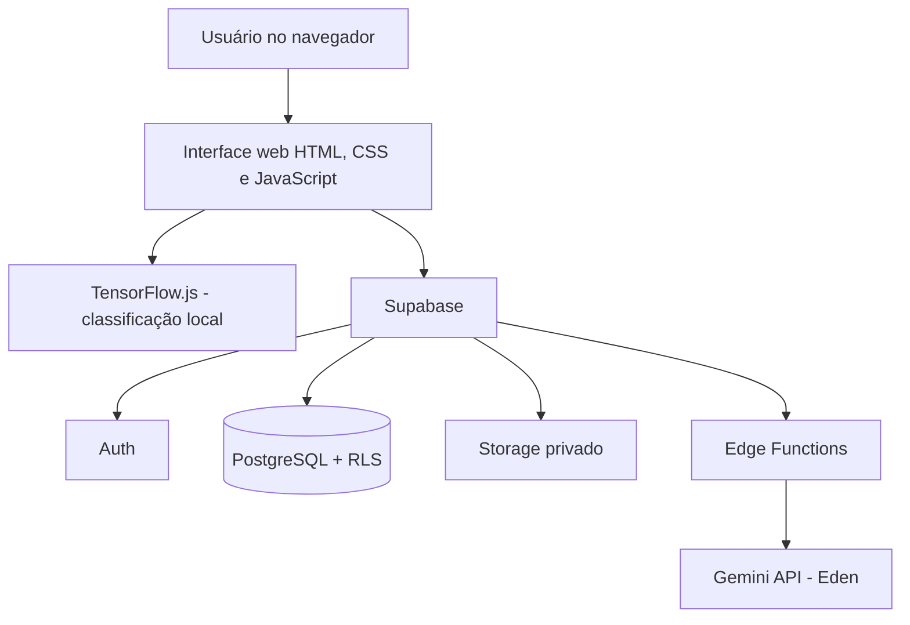
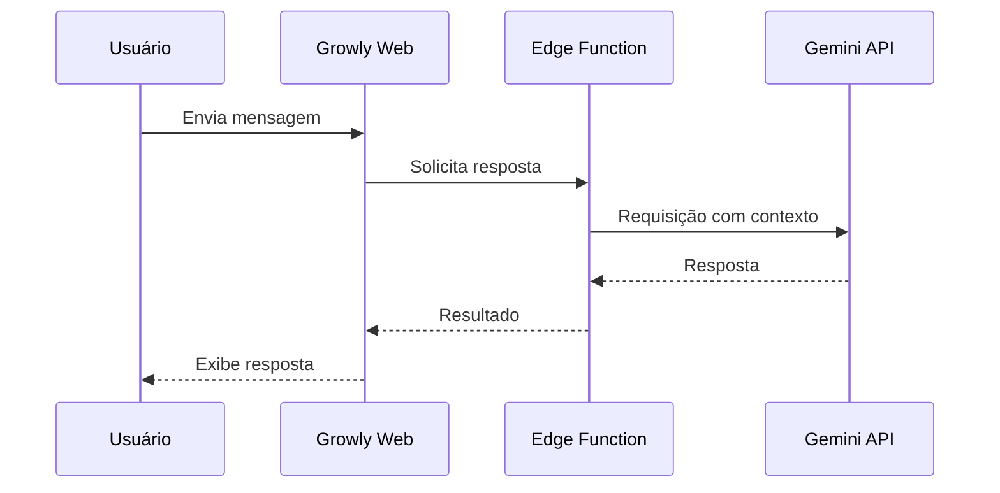
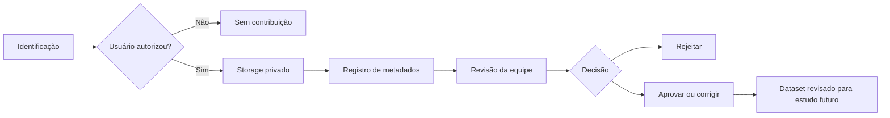
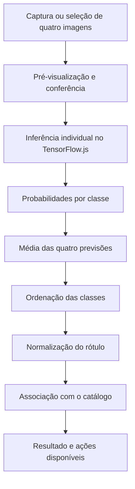
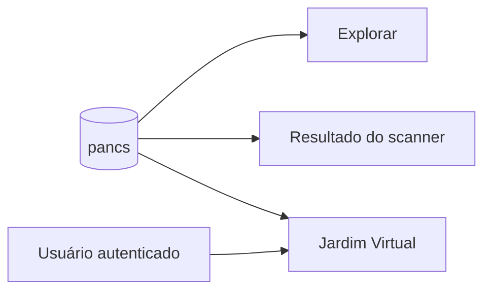

<div align="center">

# 🌱 GROWLY

### Onde cada planta encontra seu caminho para florescer.

**Inteligência artificial, biodiversidade e educação em uma única plataforma.**

Aplicação web responsiva dedicada ao reconhecimento e à descoberta das **Plantas Alimentícias Não Convencionais (PANCs)**.

[](https://growly.com.br/)


**[🌐 Conhecer o Growly](https://growly.com.br/)** · **[📚 Documentação](./Documentação/)** · **[📄 Relatórios](./Relatórios/)** · **[💻 Código da aplicação](./Protótipos/GROWLY%201.05/GROWLY/)**

</div>

---

> [!IMPORTANT]
> **Identificação assistiva, não confirmação botânica.** O Growly é um projeto educacional. Nunca consuma uma planta exclusivamente com base na classificação realizada pela aplicação. Uma previsão com alta confiança não garante identificação correta.

## ✨ Conheça o projeto

O **Growly** nasceu como Trabalho de Conclusão de Curso (TCC) do **Técnico em Desenvolvimento de Sistemas da ETEC Professor Camargo Aranha**, em São Paulo. Seu propósito é aproximar a população das PANCs por meio de uma experiência digital que combina **classificação de imagens, informações organizadas por espécie, personalização e uma assistente conversacional**.

A proposta parte de uma dificuldade real: muitas plantas com potencial alimentício permanecem pouco conhecidas, enquanto a identificação visual e o acesso a informações confiáveis representam barreiras para o público. O projeto explora como o desenvolvimento de sistemas e a inteligência artificial podem apoiar a educação sobre biodiversidade e diversificação alimentar.

### O Growly em uma visão

| 🌿 Descobrir | 📷 Identificar | 🪴 Organizar | 💬 Aprender |
|:--|:--|:--|:--|
| Consultar o catálogo de PANCs | Analisar quatro fotos da mesma planta | Salvar espécies no Jardim Virtual | Conversar com a assistente Eden IA |

### Navegação rápida

[**01 · Propósito**](#-problema-objetivos-e-impacto) · [**02 · Funcionalidades**](#-funcionalidades) · [**03 · Arquitetura**](#-arquitetura-da-solução) · [**04 · Inteligência artificial**](#-inteligência-artificial) · [**05 · Dados e segurança**](#-banco-de-dados-e-segurança) · [**06 · História**](#-trajetória-do-desenvolvimento) · [**07 · Documentação**](#-acervo-acadêmico) · [**08 · Equipe**](#-equipe-e-orientação) · [**09 · Segurança**](#-segurança-controles-auditoria-e-pendências) · [**10 · Jornadas**](#-experiência-do-usuário-e-jornadas)

---

## 🎯 Problema, objetivos e impacto

**Questão norteadora:** como uma aplicação apoiada por inteligência artificial pode auxiliar o reconhecimento de PANCs e ampliar o acesso ao conhecimento sobre essas espécies?

**Objetivo geral:** desenvolver uma aplicação web responsiva que analise imagens de plantas, sugira espécies conhecidas pelo modelo e reúna informações úteis para consulta e aprendizagem.

**Objetivos específicos:** construir um conjunto de imagens, treinar e integrar um classificador, desenvolver uma interface acessível em desktop e mobile, estruturar um banco de dados, implementar autenticação e recursos personalizados, oferecer um assistente conversacional e avaliar limitações técnicas ao longo das versões.

### Compromisso socioambiental

| ODS | Relação com o projeto |
|:--|:--|
| **ODS 2 — Fome Zero e Agricultura Sustentável** | Educação sobre diversidade alimentar e espécies de potencial alimentício. |
| **ODS 3 — Saúde e Bem-Estar** | Incentivo ao acesso responsável a informações, sem substituir profissionais especializados. |
| **ODS 4 — Educação de Qualidade** | Aproximação entre tecnologia, pesquisa, biodiversidade e aprendizagem. |

Essas relações descrevem a contribuição educacional pretendida, não resultados de impacto já comprovados.

---

## 📱 Funcionalidades

| Módulo | O que oferece | Observações |
|:--|:--|:--|
| **Scanner de PANCs** | Seleção ou captura de quatro fotografias, pré-visualização e classificação. | O resultado é uma sugestão probabilística. |
| **Explorar** | Consulta às espécies registradas no catálogo. | Informações centralizadas no banco de dados. |
| **Meu Jardim** | Coleção pessoal de espécies vinculadas à conta. | Evita duplicação das informações botânicas. |
| **Eden IA** | Conversa em linguagem natural sobre temas relacionados à plataforma. | Respostas generativas podem conter imprecisões. |
| **Conta e perfil** | Cadastro, login, gerenciamento de informações e senha. | Integração com Supabase Auth. |
| **Contribuição de imagens** | Envio opcional de fotografias autorizadas para aprimoramentos futuros. | Não é requisito para usar o scanner. |
| **Revisão administrativa** | Curadoria das imagens contribuídas. | Separação entre previsão automática e validação humana. |

<details>
<summary><strong>🔎 Como funciona a identificação por quatro fotografias?</strong></summary>

1. O usuário seleciona ou captura **quatro imagens da mesma planta**.
2. A interface permite visualizar e ajustar as fotografias antes da análise.
3. O modelo executa uma previsão para cada imagem no navegador.
4. As probabilidades são agregadas por classe e ordenadas.
5. A aplicação associa a classe sugerida ao catálogo e apresenta o resultado.
6. O usuário pode explorar informações, salvar a espécie no Jardim e, opcionalmente, autorizar a contribuição das imagens.

A utilização de quatro imagens busca reduzir a dependência de um único enquadramento, mas **não elimina classificações incorretas**.

</details>

---

## 🧱 Arquitetura da solução

O Growly separa a **classificação visual executada no navegador** dos **serviços remotos de autenticação, persistência e IA generativa**.



### Tecnologias utilizadas

| Área | Tecnologia | Aplicação no Growly |
|:--|:--|:--|
| **Front-end** | HTML5, CSS3, JavaScript | Interface, navegação, validações e integração. |
| **Classificação de imagens** | Teachable Machine, TensorFlow.js | Treinamento/exportação e inferência no navegador. |
| **Backend** | Supabase | Infraestrutura de autenticação, dados, arquivos e funções. |
| **Banco de dados** | PostgreSQL | Catálogo, contas e relações entre entidades. |
| **Controle de acesso** | Row Level Security (RLS) | Políticas de acesso aos registros. |
| **Arquivos** | Supabase Storage | Armazenamento de imagens autorizadas. |
| **IA generativa** | Gemini API + Edge Function | Respostas da assistente Eden. |
| **Ferramentas** | Git, GitHub, VS Code, Chrome DevTools | Versionamento, desenvolvimento e diagnóstico. |

**Histórico tecnológico:** etapas anteriores envolveram estudos e protótipos com MySQL, PHP, XAMPP, phpMyAdmin e React Native. Essas ferramentas não devem ser confundidas com a stack principal da versão web atual.

<details>
<summary><strong>🧭 Por que essa arquitetura?</strong></summary>

- **Inferência local:** o TensorFlow.js permite classificar imagens no navegador sem exigir uma chamada remota para cada previsão.
- **Backend integrado:** o Supabase reúne autenticação, persistência, Storage e funções de servidor.
- **Credenciais protegidas:** a integração com a Gemini é intermediada por uma Edge Function; segredos não devem ficar no JavaScript público.
- **Autorização na origem:** a interface não é uma barreira de segurança. As regras de acesso precisam ser aplicadas no banco e no armazenamento.

</details>

---

## 🤖 Inteligência artificial

O projeto utiliza **dois recursos de IA distintos**: um classificador de imagens e uma assistente de linguagem natural.

### 1. Classificador de PANCs

O modelo foi treinado no **Teachable Machine** e exportado para execução com **TensorFlow.js**. Seu escopo atual é limitado a cinco espécies principais:

| Espécie | Classe interna |
|:--|:--|
| Peixinho-da-horta | `peixinho` |
| Tanchagem | `tanchagem` |
| Ora-pro-nóbis | `ora` |
| Vinagreira | `vinagreira` |
| Taioba | `taioba` |

O modelo também inclui as classes auxiliares `nd` (não identificado) e `pessoa`.

<details>
<summary><strong>⚙️ Modelo, metadados e cálculo das previsões</strong></summary>

O pacote exportado contém `model.json`, `metadata.json` e `weights.bin`. Os metadados indicam imagens de entrada de **224 × 224 pixels**.

Para cada classe, a aplicação considera a média das probabilidades retornadas pelas quatro fotografias:

**P(c) = [p₁(c) + p₂(c) + p₃(c) + p₄(c)] / 4**

Depois, normaliza os rótulos para associá-los aos registros do catálogo. Esse passo é importante porque **um erro de integração dos labels não é necessariamente um erro do modelo**.

</details>

### 2. Eden IA

A **Eden** é a assistente conversacional do Growly. A interface envia a mensagem a uma **Supabase Edge Function**, que intermedeia a comunicação com a **Gemini API** e devolve a resposta ao usuário.



A integração prevê tratamento de indisponibilidade temporária, inclusive respostas HTTP 503. A Eden complementa a consulta ao catálogo, mas não substitui fontes científicas nem identificação especializada.

### Pesquisa de campo e dataset

A equipe realizou uma visita técnica à **Horta das Flores**, na Mooca, em **29 de abril de 2026**, produzindo registros fotográficos próprios para apoiar o estudo das espécies e o desenvolvimento do classificador.

O dataset foi organizado buscando diversidade de **ângulo, iluminação, distância, fundo e enquadramento**. Durante os testes, **Tanchagem** e **Vinagreira** apresentaram maior instabilidade em determinadas condições, motivando a necessidade de ampliação e balanceamento das imagens.

---

## 🗄️ Banco de dados e segurança

A arquitetura evoluiu de estudos iniciais em **MySQL** para uma solução baseada em **Supabase e PostgreSQL**.

### Entidades centrais

| Tabela | Responsabilidade |
|:--|:--|
| `profiles` | Informações complementares das contas. |
| `pancs` | Catálogo central de espécies. |
| `jardim` | Relação entre usuários e espécies salvas. |
| `identificacoes` | Registros relacionados às identificações. |
| `imagens` | Informações de imagens da aplicação. |
| `mensagens` | Dados associados a interações previstas pelo sistema. |
| `admins` | Identificação de contas administrativas. |
| `imagens_treinamento` | Metadados das contribuições para curadoria. |

> [!NOTE]
> Esta é uma visão **conceitual**, não a reprodução exata do esquema SQL. Consulte os diagramas e documentos de banco de dados para detalhes de chaves, colunas, relacionamentos e políticas.

### Segurança e autenticação

- **Supabase Auth:** cadastro, login e gerenciamento de sessões.
- **RLS:** políticas de acesso aos dados de usuários e recursos protegidos.
- **Storage privado:** armazenamento das fotografias contribuídas mediante autorização.
- **Administração:** verificação de privilégios no backend, não apenas ocultação de elementos da interface.
- **Senha:** política mínima de **8 caracteres**, com validação visual de letra maiúscula, número e caractere especial na interface.

<details>
<summary><strong>🔐 Auditoria de segurança — 16/10/2026</strong></summary>

Na verificação realizada no **Supabase Security Advisor**, foram registrados **0 erros, 5 avisos e 0 sugestões**.

Quatro avisos estavam relacionados à execução de funções administrativas `SECURITY DEFINER` por papéis de acesso; o quinto dizia respeito à proteção contra senhas vazadas, indisponível no plano gratuito utilizado durante a auditoria.

A equipe inspecionou funções, permissões, políticas RLS e privilégios de criação no schema público. **Os avisos não foram considerados integralmente resolvidos**; sua análise e eventual endurecimento permanecem como trabalho futuro.

A senha mínima foi elevada de **6 para 8 caracteres** no Supabase e nas branches `site` e `main`. A validação visual foi testada na aplicação publicada com entradas de sete e oito caracteres. Isso **não equivale a uma auditoria completa nem a testes funcionais de ponta a ponta**.

</details>

### Contribuições e revisão humana



**Importante:** uma fotografia contribuída não é automaticamente incluída no treinamento. A revisão humana busca evitar a incorporação de rótulos incorretos.

---


## 🧭 Experiência do usuário e jornadas

O Growly foi concebido para permitir que a pessoa descubra uma espécie, consulte informações e organize seu próprio repertório botânico sem precisar compreender os detalhes do modelo de IA.

### Jornada A — Conhecer uma espécie

1. A pessoa acessa a plataforma pelo navegador.
2. Navega até a área **Explorar**.
3. Consulta o catálogo e seleciona uma PANC.
4. Lê as informações cadastradas sobre a espécie.
5. Quando autenticada, pode relacioná-la ao próprio Jardim.

### Jornada B — Identificar uma planta

1. Acessa o scanner e autoriza o uso da câmera, quando necessário, ou escolhe imagens da galeria.
2. Fornece quatro fotografias referentes à mesma planta.
3. Confere as prévias e substitui imagens inadequadas.
4. Inicia a classificação, realizada pelo TensorFlow.js no navegador.
5. Recebe uma sugestão de espécie e um indicador de confiança.
6. Pode consultar o catálogo e adicionar a espécie ao Jardim.
7. Pode, de maneira opcional, autorizar o envio das fotografias para futura avaliação pela equipe.

### Jornada C — Aprender com a Eden

1. A pessoa abre a interface conversacional.
2. Envia uma pergunta em linguagem natural.
3. O front-end encaminha a solicitação à função de backend.
4. A função se comunica com a API Gemini e devolve a resposta.
5. A interface apresenta a resposta e permite continuar a conversa.

> A Eden complementa a consulta ao catálogo; ela não substitui identificação botânica especializada nem transforma respostas geradas por IA em fatos verificados.

### Jornada D — Curadoria de imagens

1. Uma contribuição autorizada é armazenada no ambiente privado.
2. Os metadados permitem identificar o registro e seu estado de revisão.
3. A equipe com permissão administrativa analisa a contribuição.
4. A espécie pode ser confirmada ou corrigida, e a contribuição pode ser aprovada ou rejeitada.
5. Apenas material revisado deve ser considerado na preparação de futuros conjuntos de treinamento.

---

## 🧪 Engenharia do classificador: decisões e limites

### Por que a inferência acontece no navegador?

A versão web utiliza **TensorFlow.js** para executar o modelo exportado pelo Teachable Machine diretamente no cliente. Essa escolha reduz a dependência de uma chamada remota para cada previsão visual e separa o processamento do scanner das respostas geradas pela Eden.

Essa decisão também introduz requisitos: o navegador precisa carregar os arquivos do modelo, possuir recursos computacionais suficientes e oferecer as permissões necessárias para a captura de imagens.

### Estrutura do modelo

| Arquivo | Responsabilidade |
|:--|:--|
| `model/model.json` | Descreve a arquitetura exportada e as referências aos pesos. |
| `model/metadata.json` | Informa metadados e a ordem das classes do modelo. |
| `model/weights.bin` | Contém os pesos aprendidos no treinamento. |

O conjunto documentado inclui cinco espécies principais e duas classes auxiliares:

| Nome exibido | Identificador de classe | Natureza |
|:--|:--|:--|
| Peixinho-da-horta | `peixinho` | PANC |
| Tanchagem | `tanchagem` | PANC |
| Ora-pro-nóbis | `ora` | PANC |
| Vinagreira | `vinagreira` | PANC |
| Taioba | `taioba` | PANC |
| Não identificado | `nd` | Classe auxiliar |
| Pessoa | `pessoa` | Classe auxiliar |

A entrada informada nos metadados documentados é de **224 × 224 pixels**. A ordem das classes deve ser conferida no arquivo de metadados que acompanha os pesos efetivamente publicados.

### Por que quatro fotografias?

Uma fotografia isolada pode enfatizar características diferentes conforme iluminação, ângulo, distância, fundo e enquadramento. A abordagem de quatro capturas foi adotada durante a evolução do projeto para reduzir a dependência de uma única observação.

Para uma classe `c`, se o modelo retornar quatro probabilidades, a média documentada é:

**P(c) = [p₁(c) + p₂(c) + p₃(c) + p₄(c)] / 4**

A classificação principal corresponde à classe com maior pontuação agregada. Esse método é uma estratégia de agregação, **não uma garantia de acerto**.

### Pipeline de classificação



### Mapeamento de classes e integração

O nome retornado pelo modelo nem sempre é idêntico ao nome apresentado no catálogo. Por isso, a aplicação precisa normalizar os rótulos e localizar o registro correspondente no banco.

Durante o desenvolvimento, a equipe distinguiu dois tipos de problema:

| Situação | Origem provável | Como investigar |
|:--|:--|:--|
| Previsão visual incorreta | Dataset, semelhança entre classes ou condições de captura | Examinar imagens e probabilidades do modelo. |
| Previsão correta, espécie exibida incorreta | Ordem dos labels, normalização ou associação ao banco | Conferir metadados, índices, nomes e registro de destino. |

Antes de retreinar, a equipe deve conferir o resultado bruto, a ordem das classes, o mapeamento no JavaScript e a existência da espécie no catálogo.

### Dataset e critérios de qualidade

O conjunto de imagens foi organizado buscando diversidade de ângulos, distâncias, iluminação, fundos e características visuais. Uma parte importante do material foi obtida em atividades de campo.

As avaliações anteriores registraram maior instabilidade para **Tanchagem** e **Vinagreira** em determinadas condições. Isso motivou a proposta de ampliar e balancear as amostras, além de separar adequadamente imagens de treinamento e avaliação.

<details>
<summary><strong>📊 O que seria necessário para medir o desempenho cientificamente?</strong></summary>

- Definir um conjunto de teste independente das imagens usadas no treinamento.
- Documentar a quantidade de exemplos por classe.
- Medir acertos e erros por espécie, não apenas uma taxa geral.
- Produzir uma matriz de confusão e investigar confusões recorrentes.
- Registrar condições de captura e versões do modelo comparadas.
- Evitar reutilizar como validação imagens praticamente idênticas às usadas no treinamento.

Esses são critérios recomendados para futuras avaliações; o README não apresenta métricas de precisão não comprovadas.

</details>

---

## 🗃️ Modelagem e organização dos dados

O projeto começou com estudos de modelagem relacional em **MySQL** e, ao longo da evolução da aplicação, passou a utilizar **PostgreSQL por meio do Supabase** como infraestrutura de persistência.

### Entidades e responsabilidades

| Entidade | Responsabilidade funcional |
|:--|:--|
| `profiles` | Informações complementares do usuário autenticado. |
| `pancs` | Catálogo central das espécies. |
| `jardim` | Associação entre usuário e espécies salvas. |
| `identificacoes` | Registros relacionados às identificações realizadas. |
| `imagens` | Informações associadas a imagens do sistema. |
| `mensagens` | Dados relacionados às interações previstas pela aplicação. |
| `admins` | Identificação de contas com permissões administrativas. |
| `imagens_treinamento` | Metadados das imagens contribuídas e do fluxo de revisão. |

A lista apresenta as responsabilidades descritas na documentação do projeto. Para colunas, tipos, chaves e políticas vigentes, consulte os diagramas e o esquema SQL correspondente à versão em uso.

### Centralização do catálogo

O catálogo de PANCs funciona como fonte compartilhada para **Explorar**, **Scanner** e **Jardim**. Assim, a espécie não precisa ter seus dados descritivos copiados integralmente para cada usuário.



### Jardim Virtual

O Jardim representa uma relação personalizada entre a conta e as espécies do catálogo. A aplicação pode consultar, adicionar e remover vínculos, mantendo os dados botânicos centralizados.

Essa separação é importante para consistência: uma correção na descrição de uma espécie pode refletir nos pontos da aplicação que reutilizam o mesmo registro.

### Dados estruturados e arquivos

O Growly distingue informações relacionais de arquivos binários:

- **PostgreSQL:** usuários, espécies, associações e metadados.
- **Storage:** fotografias autorizadas para contribuição, com políticas de acesso específicas.
- **Auth:** identidade, credenciais e gerenciamento de sessões.

Uma URL difícil de descobrir não constitui, por si só, uma política de autorização. A proteção deve ocorrer no serviço responsável pelo dado.

---

## 🔐 Segurança: controles, auditoria e pendências

### Autenticação e autorização são responsabilidades diferentes

**Autenticação** responde quem está acessando o Growly; **autorização** determina quais recursos essa pessoa pode consultar ou modificar. O Supabase Auth atende à primeira função, enquanto RLS, políticas de Storage e regras administrativas participam da segunda.

### Política de senha da versão 1.05.7

Em **16 de outubro de 2026**, a equipe atualizou a exigência mínima de senha de **6 para 8 caracteres**, alinhando a configuração do Supabase e a validação do cadastro e das configurações da aplicação.

| Critério exibido no cadastro | Situação |
|:--|:--|
| Pelo menos oito caracteres | Implementado na validação visual. |
| Uma letra maiúscula | Exigida pela interface. |
| Um número | Exigido pela interface. |
| Um caractere especial | Exigido pela interface. |
| Confirmação de senha | Prevista no formulário. |

Os testes visuais no site publicado confirmaram que uma senha fictícia de **sete caracteres** não satisfazia o requisito de comprimento, enquanto outra de **oito caracteres** atendia aos quatro critérios exibidos. Esses testes **não equivalem** a uma bateria completa de cadastro e redefinição de senha no backend.

A mudança da política mínima não implica redefinição automática das senhas de contas já existentes.

### Sessões e áreas protegidas

A documentação da versão 1.05.7 registra a evolução da verificação `requireAuth()`, com validação da identidade junto ao Supabase Auth antes do acesso a áreas protegidas. A existência de uma sessão no armazenamento local não deve ser tomada isoladamente como prova de autorização.

### Segurança da Eden

A comunicação com a Gemini API é intermediada por uma **Supabase Edge Function**, evitando que a chave do serviço seja incluída no JavaScript público da página.

### Auditoria de 16/10/2026

O **Security Advisor** do Supabase apresentou **0 erros, 5 avisos e 0 sugestões** no momento da verificação. Os avisos incluíam:

- Quatro notificações relacionadas à execução das funções `public.is_admin()` e `public.is_current_user_admin()` definidas como `SECURITY DEFINER`.
- Um aviso de **Leaked Password Protection** desativado, recurso informado como disponível em plano superior ao Free utilizado no projeto.

Foram examinados o propósito das funções administrativas, a existência de RLS na tabela `admins`, políticas de escrita e permissões relevantes. **Não foi demonstrada uma exploração imediata**, mas isso não equivale a uma prova de ausência de vulnerabilidades.

> [!WARNING]
> Os cinco avisos não foram integralmente resolvidos. O fortalecimento das permissões administrativas e a revisão periódica das políticas permanecem como atividades futuras.

### Boas práticas para a continuidade

- Manter segredos de serviços externos fora do código distribuído ao navegador.
- Conferir as políticas RLS de cada tabela que contenha dados privados.
- Revisar políticas do Storage independentemente das permissões do PostgreSQL.
- Validar permissões administrativas no backend, não apenas escondendo controles visuais.
- Realizar testes de acesso com contas de diferentes níveis de permissão.
- Registrar alterações de segurança e resultados de auditoria nos relatórios semanais.

---

## 🏞️ Pesquisa de campo, documentação e aprendizagem

### Visita à Horta das Flores

Em **29 de abril de 2026**, a equipe realizou uma visita técnica à **Horta das Flores**, na região da Mooca, em São Paulo. A atividade aproximou o projeto de exemplares reais das espécies estudadas e permitiu produzir registros fotográficos próprios para a pesquisa.

O material coletado foi importante para o desenvolvimento do classificador, mas quantidade de fotografias, isoladamente, não assegura qualidade de generalização. Diversidade e curadoria são igualmente relevantes.

### Da pesquisa ao produto digital

A trajetória do Growly combinou atividades distintas:

| Frente | Trabalho desenvolvido |
|:--|:--|
| Pesquisa | Estudo sobre PANCs, educação, alimentação e biodiversidade. |
| Requisitos | Definição de públicos, funcionalidades e jornadas de uso. |
| Dados | Modelagem conceitual, lógica e física e integração com persistência. |
| IA | Coleta, organização e treinamento de imagens; integração do modelo. |
| Interface | Prototipação, desenvolvimento e adaptação para diferentes telas. |
| Backend | Autenticação, dados, armazenamento e funções protegidas. |
| Qualidade | Testes, diagnósticos, correções e registros de evolução. |
| Documentação | Relatórios semanais, diário de bordo, diagramas e apresentações. |

### Organização do repositório acadêmico

```text
Cronogramas/
Diagramas/
Diário de bordo/
Documentação/
Pesquisas/
Protótipos/
Relatórios/
Videos e apresentações/
README.md
```

| Pasta | O que procurar |
|:--|:--|
| [`Cronogramas`](./Cronogramas/) | Planejamento e acompanhamento das atividades. |
| [`Diagramas`](./Diagramas/) | Representações e modelagens do sistema. |
| [`Diário de bordo`](./Di%C3%A1rio%20de%20bordo/) | Registro cronológico das atividades. |
| [`Documentação`](./Documenta%C3%A7%C3%A3o/) | Documentos acadêmicos e técnicos. |
| [`Pesquisas`](./Pesquisas/) | Material de pesquisa utilizado no TCC. |
| [`Protótipos`](./Prot%C3%B3tipos/) | Versões preservadas e experiências de desenvolvimento. |
| [`Relatórios`](./Relat%C3%B3rios/) | Relatórios de desenvolvimento e análises específicas. |
| [`Videos e apresentações`](./Videos%20e%20apresenta%C3%A7%C3%B5es/) | Material de demonstração e apresentações. |

### Relatórios semanais

O acervo de relatórios contém documentos das **Semanas 01 a 16**, além de um relatório específico sobre o banco de dados. Os relatórios registram procedimentos, decisões, problemas encontrados e resultados observados em cada período.

O relatório da **Semana 16 (12 a 16 de outubro de 2026)** documenta a revisão da política de senhas, a auditoria do Supabase, a sincronização das branches e os testes visuais realizados em produção.

### Organização acadêmica e técnica

O README apresenta a visão geral do software. A documentação acadêmica registra com maior profundidade o problema de pesquisa, a justificativa, a metodologia, o referencial teórico, as atividades realizadas e as referências bibliográficas.

Os dois tipos de material se complementam: **o README orienta a exploração do repositório; os relatórios e documentos sustentam o histórico de desenvolvimento**.

---

## 🧩 Evolução da arquitetura e lições aprendidas

### Primeiras etapas: protótipos e modelagem

As versões iniciais envolveram estudo das PANCs, organização do banco de dados, desenvolvimento de telas e experimentação com tecnologias como **React Native, PHP e MySQL**. Esses recursos pertencem à trajetória de desenvolvimento e não devem ser confundidos automaticamente com a stack da aplicação web publicada.

### Consolidação da aplicação web

Com o avanço do projeto, a equipe passou a priorizar uma experiência acessível por navegador. O front-end publicado utiliza HTML, CSS e JavaScript; o classificador roda em TensorFlow.js; e o Supabase fornece serviços de backend.

### Preservação de versões

| Versão | Marco documentado |
|:--|:--|
| `1.01` / `1.02` | Prototipação e primeiras entregas de desenvolvimento. |
| `1.03` | Versão preservada como estável em uma etapa de publicação. |
| `1.04` | Experimentos e diagnósticos do classificador. |
| `1.05` | Consolidação da arquitetura web e de serviços. |
| `1.05.6` | Etapa anterior de ajustes e evolução. |
| `1.05.7` | Refinamentos de interface, navegação, autenticação e política de senha. |

### Como interpretar as branches

- **`main`:** preserva a organização acadêmica, relatórios, pesquisas e versões do projeto.
- **`site`:** mantém na raiz os arquivos da versão web publicada.

As branches têm históricos próprios. Alterações entre elas devem ser transferidas conscientemente e verificadas antes do commit; um merge indiscriminado pode produzir conflitos e mudanças não desejadas.

### Mudanças recentes documentadas

| Referência | Alteração |
|:--|:--|
| `8fa47bc` — `site` | Atualização da política mínima de senha para oito caracteres na versão publicada e na cópia preservada. |
| `b6507ba` — `main` | Atualização correspondente nos quatro arquivos da versão 1.05 preservada. |
| `36e3d3a` — `main` | Inclusão dos relatórios das Semanas 14 a 16 e do relatório de banco de dados. |

### Lições técnicas

<details>
<summary><strong>🧠 Lições de integração, versionamento e segurança</strong></summary>

**Classificador:** é essencial separar erro do modelo de erro de mapeamento entre rótulo e catálogo.

**Dataset:** imagens em maior quantidade não substituem diversidade, curadoria e avaliação independente.

**Front-end:** mensagens e regras de formulário devem permanecer alinhadas com as restrições reais do backend.

**Segurança:** autenticação, autorização, RLS, Storage Policies e segredos de API possuem responsabilidades diferentes.

**Git:** comparar diffs antes de copiar arquivos evita substituir versões divergentes sem perceber.

**Deploy:** testes locais não substituem validação no domínio publicado, especialmente para caminhos, permissões e carregamento de recursos.

**Documentação:** decisões e limitações registradas permitem explicar não apenas o que foi construído, mas por que cada mudança aconteceu.

</details>

---

## 🕰️ Trajetória do desenvolvimento

O Growly foi desenvolvido de forma incremental, com prototipação, testes, correções e documentação contínua.

| Etapa | Evolução |
|:--|:--|
| **1.01 / 1.02** | Primeiros protótipos e consolidação de funcionalidades básicas. |
| **1.03** | Versão preservada como referência estável durante o desenvolvimento. |
| **1.04** | Experimentos e diagnósticos do classificador. |
| **1.05** | Consolidação da aplicação web e das integrações atuais. |
| **1.05.6** | Etapa anterior de refinamentos. |
| **1.05.7** | Ajustes de interface, autenticação, configurações, documentação e política de senhas. |

### Aprendizados técnicos

<details>
<summary><strong>🧪 Diagnóstico do modelo e integração</strong></summary>

A equipe observou classificações inconsistentes, especialmente em determinadas imagens de Tanchagem e Vinagreira. O processo de diagnóstico diferenciou **limitações do dataset**, **saída do modelo** e **mapeamento de labels no JavaScript**. Essa distinção evitou atribuir todo resultado incorreto exclusivamente ao treinamento.

</details>

<details>
<summary><strong>📷 Por que quatro fotografias?</strong></summary>

Os testes com uma única imagem evidenciaram variações conforme enquadramento e condições de captura. A média de quatro previsões foi adotada para reduzir a dependência de uma única foto. A estratégia melhora a robustez pretendida, mas não garante acerto.

</details>

<details>
<summary><strong>🛡️ Evolução da segurança</strong></summary>

A versão 1.05.7 recebeu verificações de sessão, revisão de permissões no Supabase e atualização da regra mínima de senha. Em 16/10/2026, a interface publicada exibiu corretamente a rejeição visual de uma senha com sete caracteres e o atendimento das regras por uma senha com oito caracteres.

</details>

### Estratégia de branches

| Branch | Finalidade |
|:--|:--|
| **`main`** | Acervo acadêmico: pesquisas, documentos, relatórios, diagramas e versões preservadas. |
| **`site`** | Arquivos da aplicação web publicados a partir da raiz da branch. |

As branches têm históricos próprios. **Não se deve presumir que um merge completo seja a forma correta de sincronização.** Mudanças precisam ser transferidas e verificadas de maneira consciente.

---

## 📚 Acervo acadêmico

A branch `main` preserva a trajetória do TCC para além do código-fonte.

| Diretório | Conteúdo |
|:--|:--|
| [📄 Documentação](./Documentação/) | Documentos acadêmicos e técnicos. |
| [📊 Diagramas](./Diagramas/) | Modelagens e representações do sistema. |
| [🗓️ Cronogramas](./Cronogramas/) | Planejamento e acompanhamento. |
| [📝 Diário de bordo](./Diário%20de%20bordo/) | Registros do processo de desenvolvimento. |
| [🔬 Pesquisas](./Pesquisas/) | Materiais de estudo e fundamentação. |
| [📑 Relatórios](./Relatórios/) | Relatórios técnicos semanais e de banco de dados. |
| [💻 Protótipos](./Protótipos/) | Versões e experimentos da aplicação. |
| [🎥 Vídeos e apresentações](./Videos%20e%20apresentações/) | Materiais de demonstração e apresentação. |

### Relatórios de desenvolvimento

Os registros semanais disponíveis na pasta **[Relatórios](./Relatórios/)** abrangem as **Semanas 01 a 16**, além de um relatório específico sobre o banco de dados. Eles documentam decisões, implementações, testes, diagnósticos e evolução do Growly.

### Metodologia

O trabalho combinou pesquisa sobre PANCs, levantamento de requisitos, modelagem de dados, prototipação, desenvolvimento incremental, experimentação com aprendizado de máquina, testes manuais e documentação técnica. O histórico do repositório permite acompanhar revisões e decisões tomadas ao longo de 2026.

---

## 🚀 Executando o projeto localmente

A versão web pode ser estudada no repositório e executada por meio de um servidor HTTP local.

```bash
git clone https://github.com/ThiagoNestor/tcc-thiago-nestor-lais-ferrari-leticia-cardoso-rebeca-carvalho.git
cd tcc-thiago-nestor-lais-ferrari-leticia-cardoso-rebeca-carvalho
git switch site
```

Na branch `site`, abra a pasta do projeto no **Visual Studio Code** e utilize uma extensão como **Live Server** para servir os arquivos por HTTP.

> [!TIP]
> Evite abrir a aplicação diretamente com `file:///`. O carregamento de modelos, requisições e permissões da câmera pode depender de um servidor HTTP e de um contexto seguro. Para acesso público à câmera, utilize HTTPS.

**Atenção:** a execução completa das integrações remotas depende de configurações válidas de Supabase e das funções de backend. Não publique credenciais privadas no repositório.

---

## 🧪 Testes, limitações e próximos passos

### O que foi avaliado ao longo do projeto

Interface responsiva, cadastro e autenticação, scanner, carregamento do modelo, classificação, integração com o catálogo, Jardim Virtual, comunicação com a Eden, permissões de backend e comportamento após a publicação.

Essas áreas representam o **escopo de testes realizados durante o desenvolvimento**; não devem ser interpretadas como certificação integral de cada funcionalidade.

### Limitações reconhecidas

- O classificador contempla **cinco espécies principais**, além de classes auxiliares.
- O desempenho depende da diversidade e do balanceamento do dataset.
- Tanchagem e Vinagreira apresentaram instabilidades em parte dos testes.
- A confiança do modelo **não é confirmação científica**.
- A Eden pode produzir respostas imprecisas.
- Permanecem recomendações de segurança e testes funcionais a aprofundar.

### Roadmap

| Prioridade de evolução | Direção |
|:--|:--|
| **Qualidade do modelo** | Ampliar o dataset, balancear classes e comparar treinamentos com métricas consistentes. |
| **Confiabilidade** | Aprofundar testes de autenticação, fluxo completo do scanner e integração com backend. |
| **Segurança** | Reavaliar avisos do Supabase e revisar continuamente permissões e políticas. |
| **Experiência** | Melhorar acessibilidade, responsividade e tratamento de erros. |
| **Conteúdo** | Expandir catálogo e espécies após pesquisa e validação adequadas. |

---

## 👥 Equipe e orientação

**ETEC Professor Camargo Aranha — Técnico em Desenvolvimento de Sistemas — TCC 2026**

| Integrantes | Participação |
|:--|:--|
| **Thiago Nestor Afonso dos Santos** | Desenvolvimento e atividades do projeto. |
| **Laís Silva Ferrari** | Pesquisa, documentação e atividades do projeto. |
| **Letícia Rodrigues Cardoso** | Desenvolvimento e atividades do projeto. |
| **Rebeca Carvalho Trindade** | Desenvolvimento e atividades do projeto. |

**Orientação acadêmica:** Prof. **Ricardo Faria Palhares**.  
**Apoio e colaboração:** Dr. **Luiz Antonio de Lima**.

A trajetória do projeto também contou com contribuições de professores, colaboradores e instituições, incluindo a **Horta das Flores**, parceira importante na aproximação com as PANCs e na produção de registros fotográficos.

---

## 📬 Contato e links

| Canal | Endereço |
|:--|:--|
| **Aplicação oficial** | [growly.com.br](https://growly.com.br/) |
| **Repositório** | [GitHub do Growly](https://github.com/ThiagoNestor/tcc-thiago-nestor-lais-ferrari-leticia-cardoso-rebeca-carvalho) |
| **Contato do projeto** | [growlypancs@gmail.com](mailto:growlypancs@gmail.com) |

<div align="center">

---

### 🌱 Growly

**Tecnologia para descobrir, aprender e florescer.**

*ETEC Professor Camargo Aranha · São Paulo · 2026*

**[↑ Voltar ao início](#-growly)**

</div>
