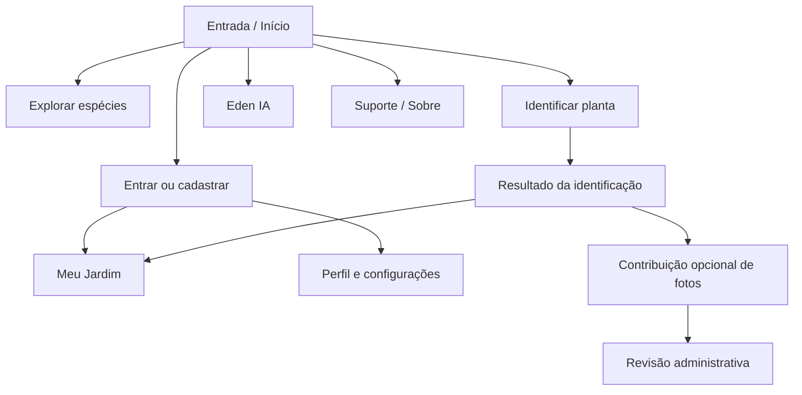
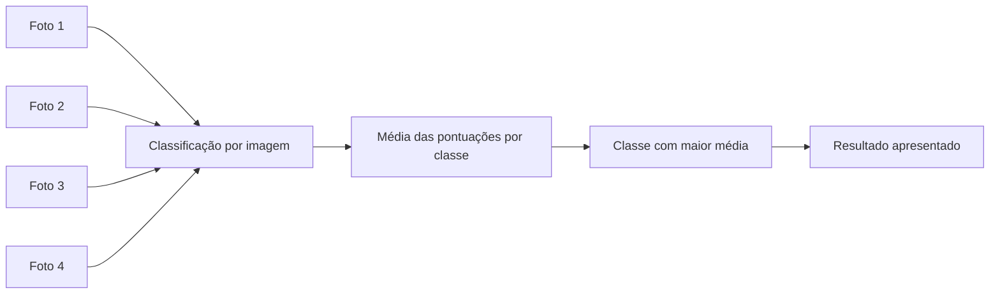
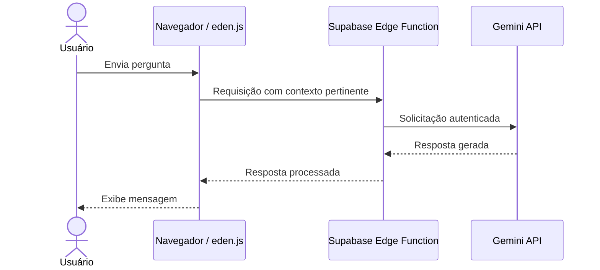
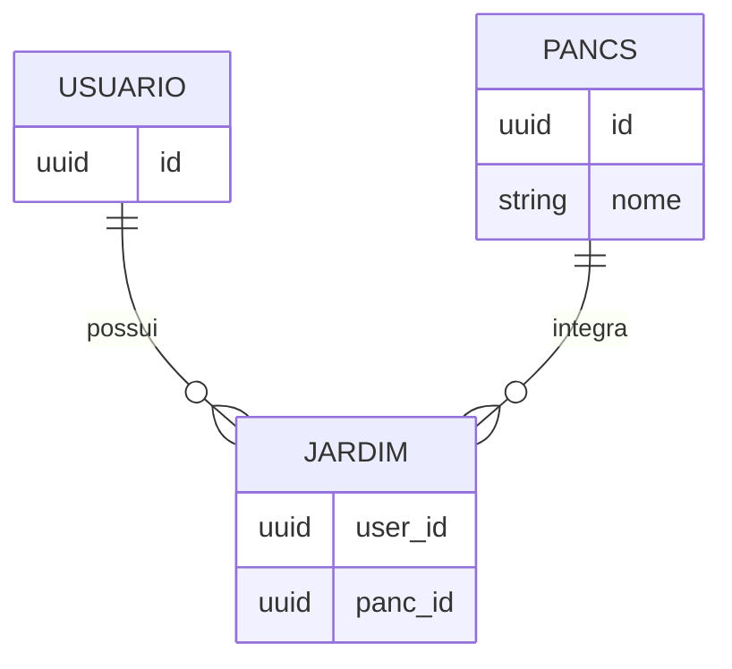
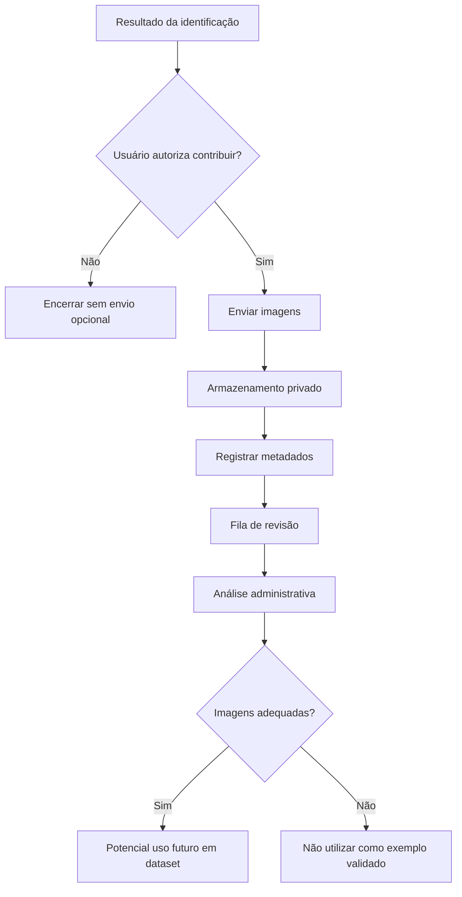
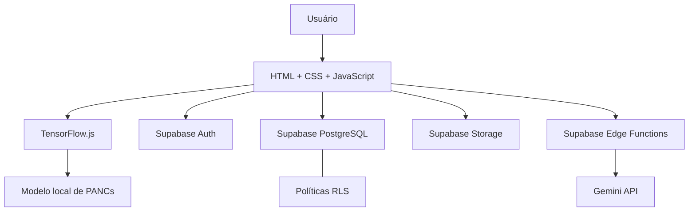
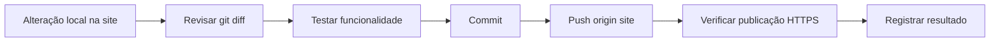

<div align="center">

# 🌱 Growly

### Manual da aplicação web · Guia técnico · Branch `site`

**Identificação assistida de PANCs, conhecimento botânico e jardim virtual.**

[](https://growly.com.br/)
[](https://growly.com.br/)
[](https://github.com/ThiagoNestor/tcc-thiago-nestor-lais-ferrari-leticia-cardoso-rebeca-carvalho/tree/site)
[](https://github.com/ThiagoNestor/tcc-thiago-nestor-lais-ferrari-leticia-cardoso-rebeca-carvalho/tree/main)

**Onde cada planta encontra seu caminho para florescer.**

</div>

---

> [!IMPORTANT]
> **Este README documenta a aplicação publicada.** Ele combina o manual de uso com uma visão técnica de arquitetura, módulos, dados, inteligência artificial, segurança e manutenção. Algumas informações de implementação são derivadas do README anterior e do código compartilhado de `js/app.js`; detalhes internos dos demais módulos devem ser conferidos no código antes de alterações de produção.

> [!CAUTION]
> **Não consuma plantas com base apenas na identificação do Growly.** O classificador é uma ferramenta educacional e pode errar. Confirme a espécie por fontes botânicas confiáveis e profissionais qualificados quando necessário.

## 📚 Índice

1. [Visão geral](#-visão-geral)
2. [Mapa da aplicação](#-mapa-da-aplicação)
3. [Manual de utilização](#-manual-de-utilização)
4. [Scanner: experiência do usuário](#-scanner-experiência-do-usuário)
5. [Scanner: implementação e modelo](#-scanner-implementação-e-modelo)
6. [Eden IA](#-eden-ia)
7. [Catálogo e Meu Jardim](#-catálogo-e-meu-jardim)
8. [Contas, perfil e configurações](#-contas-perfil-e-configurações)
9. [Contribuição de imagens e revisão](#-contribuição-de-imagens-e-revisão)
10. [Arquitetura e tecnologias](#-arquitetura-e-tecnologias)
11. [Dados e integração com Supabase](#-dados-e-integração-com-supabase)
12. [Estrutura do repositório](#-estrutura-do-repositório)
13. [Instalação e execução local](#-instalação-e-execução-local)
14. [Segurança e privacidade](#-segurança-e-privacidade)
15. [Testes, limitações e diagnóstico](#-testes-limitações-e-diagnóstico)
16. [Deploy, branches e manutenção](#-deploy-branches-e-manutenção)
17. [Equipe e referências](#-equipe-e-referências)

---

## 🌿 Visão geral

O **Growly** é uma aplicação web responsiva sobre **Plantas Alimentícias Não Convencionais (PANCs)**. O projeto reúne identificação visual assistida por inteligência artificial, consulta a espécies, organização de um jardim virtual, assistência conversacional e um fluxo opcional de contribuição de fotografias.

A aplicação pode ser acessada em **[growly.com.br](https://growly.com.br/)**, sem instalação obrigatória. Recursos como câmera, autenticação e serviços remotos dependem das permissões e da conectividade do dispositivo.

| Característica | Implementação documentada |
|---|---|
| Interface | HTML, CSS e JavaScript puro, sem etapa de build no núcleo compartilhado |
| Identificação | Modelo exportado do Teachable Machine, executado com TensorFlow.js no navegador |
| Backend | Supabase: autenticação, PostgreSQL, armazenamento e funções de borda |
| Assistente | Eden, com integração Gemini intermediada por Supabase Edge Function |
| Dados pessoais | Associados à sessão autenticada e sujeitos às políticas de autorização do backend |
| Distribuição | Branch `site` como estrutura de publicação; `main` como documentação e histórico do TCC |

### O que o Growly faz — e o que não faz

O Growly **sugere** uma classe botânica a partir de imagens, apresenta informações sobre PANCs e oferece ferramentas de organização e aprendizagem. Ele **não certifica a identidade de uma planta**, não substitui avaliação especializada e não garante que uma espécie seja segura para consumo.

---

## 🧭 Mapa da aplicação

A estrutura disponibilizada na branch `site` contém **16 páginas HTML** e **14 módulos JavaScript**, organizados por função.

| Página | Módulo JS associado | Finalidade |
|---|---|---|
| `index.html` | Núcleo compartilhado conforme carregamento da página | Entrada da aplicação |
| `home.html` | `home.js` | Página inicial e acesso aos recursos |
| `cadastro.html` | `cadastro.js` | Criação de conta |
| `login.html` | `login.js` | Autenticação |
| `recuperar-senha.html` | `recuperar-senha.js` | Solicitação de recuperação |
| `nova-senha.html` | `nova-senha.js` | Definição de nova senha |
| `identificar.html` | `identificar.js`, `panc-model.js` | Seleção de imagens, classificação e resultado |
| `explorar.html` | `explorar.js` | Consulta ao catálogo |
| `jardim.html` | `jardim.js` | Coleção pessoal de espécies |
| `eden.html` | `eden.js` | Conversa com a assistente |
| `perfil.html` | `perfil.js` | Visualização do perfil |
| `configuracoes.html` | `configuracoes.js` | Gestão da conta e segurança |
| `revisao.html` | `revisao.js` | Fluxos de revisão administrativa |
| `sobre.html` | Comportamento conforme scripts carregados | Informações institucionais |
| `suporte.html` | Comportamento conforme scripts carregados | Informações de suporte |

> **Nota técnica:** a associação acima reflete a nomenclatura e a estrutura dos arquivos observados. Dependências exatas de cada HTML devem ser confirmadas em suas tags `<script>`.

### Navegação inferior

O `js/app.js` define explicitamente quatro destinos na barra de navegação compartilhada:

| Item | Destino | Ícone |
|---|---|---|
| Início | `home.html` | `assets/icon-home.png` |
| Eden IA | `eden.html` | `assets/icon-eden.png` |
| Suporte | `suporte.html` | `assets/icon-suporte.png` |
| Perfil | `perfil.html` | `assets/icon-perfil.png` |

O catálogo **Explorar** permanece acessível pelos fluxos internos da aplicação, mesmo não fazendo parte desses quatro itens.



---

## 📱 Manual de utilização

### 1. Acessar a plataforma

Abra **https://growly.com.br/** em um navegador moderno. O layout foi projetado para telas de celulares e computadores. Para utilizar a câmera, autorize o acesso quando o navegador solicitar. A seleção de arquivos da galeria pode ser uma alternativa, quando oferecida pela interface.

### 2. Conhecer as espécies

Entre em **Explorar** por um dos acessos disponíveis na aplicação. Consulte o catálogo e abra as informações da PANC de interesse. Essa navegação não depende da execução do classificador.

### 3. Criar uma conta

Acesse **Cadastro**, preencha os dados solicitados e confirme a senha. A política de senha foi atualizada para **mínimo de 8 caracteres**, além dos critérios de complexidade exibidos pela interface. O fluxo de confirmação de e-mail depende da configuração ativa do Supabase Auth.

### 4. Entrar e manter sua sessão

Em **Login**, autentique-se com as credenciais cadastradas. As páginas que exigem autenticação devem validar o usuário com o serviço de autenticação, não apenas confiar em dados salvos no navegador. Em caso de sessão inválida, o núcleo compartilhado redireciona para `login.html`.

### 5. Recuperar o acesso

Use **Recuperar senha** e siga as orientações recebidas pelo mecanismo de recuperação. A página `nova-senha.html` integra o fluxo de definição de uma nova senha.

### 6. Utilizar as funcionalidades personalizadas

Com uma sessão válida, acesse os recursos associados à sua conta, como o **Meu Jardim**, **Perfil** e **Configurações**. As permissões efetivas de leitura e escrita devem ser aplicadas no backend.

<details>
<summary><strong>Resumo rápido: por onde começar?</strong></summary>

1. Abra o site e explore as espécies.
2. Crie uma conta se desejar usar recursos personalizados.
3. Use o scanner com quatro imagens da mesma planta.
4. Analise a sugestão e as informações disponíveis.
5. Organize as espécies no Jardim, quando aplicável.
6. Converse com a Eden para dúvidas educativas sobre PANCs.

</details>

---

## 📷 Scanner: experiência do usuário

O scanner foi concebido para analisar **quatro fotografias da mesma planta**, reduzindo a dependência de um único enquadramento.

### Passo a passo

1. Abra a página **Identificar**.
2. Capture ou selecione **quatro imagens da mesma planta**.
3. Confira a pré-visualização e substitua fotografias inadequadas.
4. Inicie a análise quando as quatro posições estiverem preenchidas.
5. Aguarde o processamento e consulte a espécie sugerida e a pontuação exibida.
6. Utilize as ações disponibilizadas pelo resultado, como consultar a espécie, adicioná-la ao Jardim ou contribuir com imagens, conforme o estado da sessão e da interface.

**Recomendações para fotografar:** prefira boa iluminação, foco adequado, folhas e outras características visíveis, enquadramentos diferentes e fundo sem excesso de distrações. Evite misturar plantas distintas nas quatro entradas.

### Interpretando a confiança

A confiança apresentada corresponde à **pontuação produzida pelo classificador para uma classe**. Não é uma confirmação botânica, nem uma garantia de comestibilidade. Uma pontuação elevada pode estar errada quando a espécie está fora do conjunto treinado ou se parece visualmente com outra classe.



---

## 🧠 Scanner: implementação e modelo

### Treinamento e execução

O **Teachable Machine** foi utilizado para organizar o treinamento e exportar o classificador de imagens. O modelo exportado é carregado no navegador pelo **TensorFlow.js**, responsável pela inferência local. Assim, a classificação visual não depende de enviar cada imagem à Gemini: **scanner e Eden são sistemas de IA distintos**.

O diretório do modelo reúne os artefatos de exportação:

```text
model/
├── model.json       # definição da arquitetura e referências aos pesos
├── metadata.json    # metadados e nomes das classes
└── weights.bin      # parâmetros treinados
```

Os metadados documentados indicam imagens de entrada de **224 × 224 pixels**. A interface pode utilizar outros tamanhos de captura ou pré-visualização; o pré-processamento deve adequar as entradas às exigências do modelo.

### Classes principais

| Nome exibido | Rótulo interno documentado |
|---|---|
| Peixinho-da-horta | `peixinho` |
| Tanchagem | `tanchagem` |
| Ora-pro-nóbis | `ora` |
| Vinagreira | `vinagreira` |
| Taioba | `taioba` |

O classificador também possui classes auxiliares **`nd`** (não identificado) e **`pessoa`**. Elas não devem ser confundidas com novas espécies de PANCs.

### Agregação das quatro imagens

Para cada classe `c`, a abordagem documentada calcula a média das pontuações individuais:

\[
P(c) = \frac{p_1(c) + p_2(c) + p_3(c) + p_4(c)}{4}
\]

A classe com maior média é utilizada para a sugestão final. **A média não elimina erros sistemáticos**, especialmente em classes com dados insuficientes ou imagens muito parecidas.

### Responsabilidades dos módulos

| Arquivo | Responsabilidade documentada |
|---|---|
| `js/panc-model.js` | Carregamento do modelo e operações de classificação |
| `js/identificar.js` | Fluxo de imagens, interação com o scanner e apresentação do resultado |
| `model/metadata.json` | Ordem e identificação das classes |
| `js/app.js` | Integração compartilhada com dados e utilitários de interface |

> [!WARNING]
> **Ao substituir o modelo, atualize e valide o conjunto completo** (`model.json`, `metadata.json`, `weights.bin`). Confira a ordem dos rótulos e o mapeamento entre classe prevista e registro da PANC no banco. Uma predição correta com rótulo associado incorretamente ainda gera uma experiência errada.

<details>
<summary><strong>Checklist para validar uma nova versão do classificador</strong></summary>

- [ ] Os três arquivos exportados pertencem ao mesmo treinamento.
- [ ] O carregamento via HTTP/HTTPS funciona sem erros.
- [ ] As classes do `metadata.json` correspondem ao mapeamento JavaScript.
- [ ] Cada uma das cinco PANCs foi testada com imagens adequadas.
- [ ] Entradas não pertencentes às espécies principais foram testadas.
- [ ] As quatro imagens participam da agregação.
- [ ] O resultado aponta para a espécie correta do catálogo.
- [ ] O fluxo foi testado no navegador de computador e no celular.

</details>

---

## 💬 Eden IA

A **Eden** é a assistente conversacional do Growly, voltada a dúvidas e conteúdos relacionados às PANCs.

### Como usar

Acesse **Eden IA** na navegação inferior, escreva uma pergunta e aguarde a resposta. Perguntas objetivas, com o contexto necessário, tendem a facilitar a compreensão. As respostas são **geradas por IA e podem conter imprecisões**.

### Como a integração funciona

O fluxo documentado utiliza uma **Supabase Edge Function** como intermediária entre o navegador e a **Gemini API**. A credencial privada da Gemini permanece no ambiente de backend, não no JavaScript público. Parte do histórico recente pode ser incluída na solicitação para manter o contexto conversacional.



O README anterior registra tratamento de determinadas falhas **HTTP 503**, incluindo tentativas adicionais antes de apresentar erro. Os parâmetros exatos dessas tentativas devem ser conferidos em `js/eden.js` e na Edge Function correspondente.

**Limitação:** a Eden não substitui identificação botânica profissional, atendimento médico ou validação de segurança alimentar.

---

## 📚 Catálogo e Meu Jardim

### Explorar: catálogo compartilhado

A página **Explorar** apresenta informações sobre as PANCs cadastradas. No código compartilhado, a função `carregarPancs()` consulta a tabela `pancs` com `select('*')` e ordena por `nome`. A interface pode utilizar imagens locais associadas aos slugs de cada espécie.

O objeto `PLANT_IMAGES` em `js/app.js` contempla recursos visuais para **azedinha, ora-pro-nóbis, taioba, vinagreira, capuchinha, peixinho-da-horta e tanchagem**. **Ter imagem no catálogo não significa que a espécie seja reconhecida pelo scanner**: o modelo documentado trabalha principalmente com cinco PANCs.

### Meu Jardim: coleção pessoal

O **Meu Jardim** permite relacionar espécies a uma conta autenticada, sem duplicar todos os dados botânicos para cada pessoa. O código compartilhado utiliza a tabela `jardim` e os campos `user_id` e `panc_id`.

- `carregarJardim()` consulta `panc_id` na tabela `jardim` e retorna uma lista de identificadores.
- `alternarJardim(userId, pancId, salvo)` **remove** a relação quando `salvo` é verdadeiro ou **insere** a relação quando é falso.
- As políticas de autorização no banco devem garantir que cada pessoa só possa manipular as relações permitidas.



> **Diagrama lógico simplificado:** os nomes e tipos apresentados para as entidades `USUARIO` e `PANCS` são ilustrativos. Os campos `user_id` e `panc_id` da tabela `jardim` e a consulta à tabela `pancs` foram observados no `app.js`; consulte o esquema SQL para tipos, constraints e relações exatas.

Uma espécie já presente no Jardim pode continuar elegível a **nova contribuição de fotografias**, conforme o fluxo documentado de identificação.

---

## 👤 Contas, perfil e configurações

### Autenticação

O **Supabase Auth** gerencia a autenticação. No núcleo compartilhado, `requireAuth()` executa `db.auth.getUser()`. Se a resposta contiver erro ou não retornar usuário, a aplicação chama `signOut()` e redireciona para `login.html`.

Esse procedimento verifica a identidade junto ao serviço em vez de depender exclusivamente de uma sessão armazenada localmente. Ele **não substitui** políticas RLS no banco.

### Cadastro e recuperação

O fluxo envolve `cadastro.html`, `login.html`, `recuperar-senha.html` e `nova-senha.html`, com módulos JavaScript próprios. A versão atualizada exige **no mínimo 8 caracteres na senha**, respeitando também os requisitos de complexidade indicados na interface. A confirmação de e-mail depende das configurações do projeto Supabase.

### Perfil

`perfil.html` e `js/perfil.js` compõem a área de perfil e apresentação de informações associadas à conta. O módulo merece atenção especial na manutenção, pois possui aproximadamente **1.000 linhas** na versão analisada.

### Configurações

A documentação existente divide as configurações em:

| Área | Finalidade |
|---|---|
| Conta | Gerenciar dados disponibilizados pela interface |
| Segurança | Gerenciar senha e controles relacionados |
| Administração | Acesso condicionado ao privilégio administrativo |
| Sessão | Encerrar a sessão |

O logout foi centralizado em **Configurações**, evitando ações duplicadas em telas diferentes.

---

## 🖼️ Contribuição de imagens e revisão

Após uma identificação, o usuário pode **optar por autorizar o envio das quatro fotografias** para possível aprimoramento futuro do dataset. A contribuição não é necessária para utilizar o scanner.



### Por que existe revisão?

Uma previsão do modelo **não equivale a um rótulo confirmado**. Incorporar imagens automaticamente com a classe prevista poderia perpetuar erros. O processo de revisão separa a **contribuição do usuário** da **validação da equipe**.

### Administração

A página `revisao.html` e o módulo `js/revisao.js` dão suporte ao fluxo de revisão. O módulo é um dos mais extensos do projeto, com aproximadamente **2.163 linhas**. O acesso administrativo deve ser protegido **no backend**, independentemente de links ocultos ou verificações visuais no front-end.

<details>
<summary><strong>Cuidados técnicos com imagens contribuídas</strong></summary>

- Solicitar autorização clara antes de enviar fotografias.
- Manter as permissões de leitura e escrita adequadas no Storage.
- Associar metadados necessários ao processo de revisão.
- Não assumir que a espécie sugerida é a espécie verdadeira.
- Restringir operações de revisão a contas autorizadas.
- Avaliar retenção, exclusão e exposição de dados conforme as políticas do projeto.

</details>

---

## 🏗️ Arquitetura e tecnologias

A aplicação combina **interface estática no navegador**, **inferência local de imagens** e **serviços gerenciados de backend**.



### Tecnologia por tecnologia

| Tecnologia | Papel no Growly | Como é utilizada |
|---|---|---|
| **HTML5** | Estrutura | Define páginas, formulários, navegação e regiões da interface |
| **CSS3** | Apresentação | Estilos, identidade visual, organização e responsividade |
| **JavaScript** | Comportamento | Eventos, renderização dinâmica, validação, navegação e integrações |
| **Supabase JavaScript Client** | Comunicação com backend | Inicializado em `app.js` com `supabase.createClient(...)` |
| **Supabase Auth** | Identidade e sessão | Cadastro, login, recuperação e validação do usuário |
| **PostgreSQL** | Persistência | Catálogo, relações do Jardim e demais dados do sistema |
| **Row Level Security** | Autorização | Regras de acesso aos registros no banco |
| **Supabase Storage** | Arquivos | Armazenamento de imagens contribuídas, conforme políticas configuradas |
| **Supabase Edge Functions** | Lógica de servidor | Intermediação segura de serviços externos, como a Eden |
| **Teachable Machine** | Treinamento | Preparação e exportação do classificador visual |
| **TensorFlow.js** | Inferência | Execução do modelo no navegador |
| **Gemini API** | IA generativa | Respostas conversacionais da Eden via backend |
| **Git / GitHub** | Versionamento | Histórico, branches e publicação do código |

### O que acontece no carregamento de uma página?

No `js/app.js`, o evento `DOMContentLoaded` chama três funções compartilhadas:

1. `mountLeaves()`: aplica folhas decorativas aos elementos marcados com `data-leaf`.
2. `mountHeader()`: cria um cabeçalho com título escapado e botão de voltar.
3. `mountNav()`: monta a barra inferior em um elemento marcado com `data-nav`.

O botão voltar utiliza o histórico do navegador quando disponível; caso contrário, direciona para `home.html`. O item ativo da navegação é identificado a partir do nome da página atual.

### Utilitários importantes de `app.js`

| Função ou constante | Função no sistema |
|---|---|
| `ASSETS` | Centraliza caminhos de ícones, cards e decoração |
| `PLANT_IMAGES` | Relaciona slugs a imagens locais de espécies |
| `plantImage(slug)` | Retorna imagem correspondente ou fallback |
| `esc(value)` | Escapa `&`, `<`, `>` e aspas antes de inserir texto em HTML |
| `NAV_ITEMS` | Define os quatro itens da navegação inferior |
| `mountNav()` | Renderiza a barra de navegação |
| `mountLeaves()` | Insere elementos visuais decorativos |
| `mountHeader()` | Monta o cabeçalho e ação de retorno |
| `requireAuth()` | Verifica a identidade autenticada |
| `carregarPancs()` | Busca espécies em `pancs` |
| `carregarJardim()` | Busca identificadores em `jardim` |
| `alternarJardim(...)` | Insere ou exclui uma relação usuário–PANC |

**Observação:** `esc()` é uma proteção pontual para inserção de texto em HTML; sua existência não garante, por si só, que toda a aplicação esteja imune a XSS. Cada ponto de renderização deve ser revisado.

---

## 🗃️ Dados e integração com Supabase

### Cliente JavaScript

O núcleo compartilhado inicializa o cliente Supabase a partir de uma **URL de projeto** e uma **chave publicável**. Essas informações permitem ao navegador chamar os serviços previstos para clientes públicos, mas **não concedem acesso irrestrito**: a autorização deve ser efetivamente aplicada por RLS, políticas de Storage e verificações nas funções de backend.

Por segurança e manutenção, este README **não reproduz valores de configuração**. Consulte `js/app.js` para a configuração pública atualmente utilizada e o painel Supabase para regras e segredos de servidor.

### Operações confirmadas em `app.js`

| Recurso | Operação | Observação |
|---|---|---|
| `pancs` | `select('*').order('nome')` | Lista espécies em ordem alfabética |
| `jardim` | `select('panc_id')` | Recupera referências às PANCs do Jardim |
| `jardim` | `insert({user_id, panc_id})` | Adiciona associação |
| `jardim` | `delete().eq('user_id', ...).eq('panc_id', ...)` | Remove associação específica |
| Auth | `getUser()` | Verifica o usuário autenticado |
| Auth | `signOut()` | Encerra sessão inválida no fluxo protegido |

### Separação entre autenticação e autorização

- **Autenticação:** determina quem está acessando o sistema.
- **Autorização:** determina quais dados e operações aquela pessoa pode acessar.
- **RLS:** aplica regras de acesso por linha no PostgreSQL.
- **Storage Policies:** regulam operações sobre arquivos e objetos.
- **Edge Functions:** executam lógica de servidor e protegem credenciais privadas.

> [!NOTE]
> O esquema SQL completo, os nomes de todas as tabelas, as funções SQL, os buckets e as políticas não foram fornecidos nesta etapa. Este README documenta os elementos confirmados e o fluxo descrito anteriormente; para uma referência de banco 100% exata, consulte os arquivos SQL e os relatórios na branch `main`.

---

## 🗂️ Estrutura do repositório

A raiz observada da branch `site` está organizada assim:

```text
site/
├── CNAME
├── README.md
├── index.html
├── home.html
├── cadastro.html
├── login.html
├── recuperar-senha.html
├── nova-senha.html
├── identificar.html
├── explorar.html
├── jardim.html
├── eden.html
├── perfil.html
├── configuracoes.html
├── revisao.html
├── sobre.html
├── suporte.html
├── assets/
├── css/
├── js/
│   ├── app.js
│   ├── cadastro.js
│   ├── configuracoes.js
│   ├── eden.js
│   ├── explorar.js
│   ├── home.js
│   ├── identificar.js
│   ├── jardim.js
│   ├── login.js
│   ├── nova-senha.js
│   ├── panc-model.js
│   ├── perfil.js
│   ├── recuperar-senha.js
│   └── revisao.js
├── model/
│   ├── model.json
│   ├── metadata.json
│   └── weights.bin
└── Protótipos/
```

### Módulos JavaScript: tamanho observado

| Módulo | Linhas |
|---|---:|
| `revisao.js` | 2.163 |
| `identificar.js` | 1.966 |
| `perfil.js` | 1.000 |
| `configuracoes.js` | 580 |
| `cadastro.js` | 410 |
| `eden.js` | 327 |
| `app.js` | 208 |
| `nova-senha.js` | 92 |
| `explorar.js` | 87 |
| `login.js` | 71 |
| `jardim.js` | 55 |
| `recuperar-senha.js` | 46 |
| `panc-model.js` | 42 |
| `home.js` | 16 |
| **Total** | **7.063** |

Esses números são um retrato da versão examinada, não um limite fixo para versões futuras.

---

## 💻 Instalação e execução local

### Pré-requisitos

- Git para obter o código.
- Navegador atualizado.
- Servidor HTTP local, como **Live Server** no Visual Studio Code ou o servidor simples do Python.
- Conexão com a internet para os serviços remotos e bibliotecas que não estejam armazenadas localmente.

### 1. Clonar o repositório

```bash
git clone https://github.com/ThiagoNestor/tcc-thiago-nestor-lais-ferrari-leticia-cardoso-rebeca-carvalho.git
cd tcc-thiago-nestor-lais-ferrari-leticia-cardoso-rebeca-carvalho
git switch site
```

### 2. Iniciar um servidor local

**Opção A — VS Code:** abra a pasta do projeto e execute **Live Server** na página inicial.

**Opção B — Python instalado:**

```bash
python -m http.server 8000
```

Acesse `http://localhost:8000/` no computador. A porta é um exemplo e pode ser alterada conforme a ferramenta utilizada.

### 3. Testar o fluxo

Abra a página inicial, navegue pelo catálogo, verifique a autenticação e confirme se o scanner carrega os arquivos do modelo. Recursos remotos só funcionarão se as configurações, políticas e serviços associados estiverem disponíveis.

### Por que não abrir com `file:///`?

O carregamento de JSON, pesos do modelo, requisições e APIs do navegador pode falhar por restrições de origem. Execute o projeto em **HTTP local** ou **HTTPS publicado**. Para câmera em dispositivos móveis, prefira HTTPS: alguns recursos exigem um contexto seguro.

---

## 🔐 Segurança e privacidade

### Princípios de implementação

1. **Segredos de servidor não pertencem ao front-end.** Nunca publique chaves `service_role`, tokens administrativos, credenciais privadas ou chave Gemini em HTML/JavaScript público.
2. **Chave publicável não substitui RLS.** O controle de acesso deve ser imposto no Supabase.
3. **Links ocultos não criam autorização.** Rotas e operações administrativas precisam de verificação efetiva no backend.
4. **Dados recebidos exigem tratamento.** Escapar texto ao inserir HTML é uma medida importante, mas cada contexto de uso requer revisão.
5. **Imagens contribuídas exigem consentimento e proteção.** A contribuição é opcional e passa por revisão.
6. **Senhas e recuperação precisam de testes completos.** Validar a interface não é o mesmo que validar todo o fluxo de autenticação.

### Auditoria e pontos de atenção

A revisão recente do Supabase Security Advisor foi registrada com **zero erros e cinco avisos**: quatro associados à exposição/permissões de execução de funções SQL `SECURITY DEFINER` (`public.is_admin()` e `public.is_current_user_admin()`) e um relacionado à proteção contra senhas vazadas, dependente das opções do plano. Esses avisos **não devem ser descritos como resolvidos** sem nova verificação e evidência.

A política mínima de senha foi atualizada de **6 para 8 caracteres** nas interfaces de cadastro e alteração de senha. A configuração efetiva do provedor de autenticação deve permanecer coerente com as validações da interface.

<details>
<summary><strong>Checklist de segurança antes de publicar</strong></summary>

- [ ] Nenhum segredo privado foi incluído no commit.
- [ ] RLS está habilitado e suas políticas foram revisadas.
- [ ] Operações administrativas são verificadas no servidor.
- [ ] Buckets e políticas de Storage estão corretos.
- [ ] Os fluxos de cadastro, login, logout e recuperação foram testados.
- [ ] As contribuições exigem consentimento e respeitam o fluxo de revisão.
- [ ] Alertas do Security Advisor foram registrados e reavaliados.
- [ ] A aplicação foi testada em HTTPS após o deploy.

</details>

---

## 🧪 Testes, limitações e diagnóstico

### Matriz de verificação funcional

| Área | Verificação recomendada |
|---|---|
| Entrada | `index.html` e `home.html` carregam corretamente |
| Navegação | Quatro itens inferiores e links internos funcionam |
| Cadastro | Regras de senha, confirmação e feedback funcionam |
| Login | Sessão válida entra; sessão inválida é redirecionada |
| Recuperação | Solicitação e definição de nova senha completam o fluxo |
| Explorar | Catálogo e imagens carregam sem associações erradas |
| Jardim | Adicionar, consultar e remover espécies respeita o usuário |
| Scanner | Quatro imagens, modelo, agregação e resultado funcionam |
| Eden | Mensagens, resposta e tratamento de indisponibilidade funcionam |
| Perfil | Dados e informações exibidas correspondem à sessão |
| Configurações | Alterações e logout funcionam conforme previsto |
| Revisão | Usuário comum não obtém privilégios administrativos |
| Responsividade | Testes em desktop e celular real |
| Publicação | Arquivos, links, domínio e cache conferidos após o push |

### Limitações conhecidas

- O classificador cobre **cinco PANCs principais**, além das classes auxiliares.
- **Tanchagem e Vinagreira** apresentaram instabilidade em testes anteriores; a ampliação e revisão do dataset continuam relevantes.
- Fotografias com iluminação ruim, enquadramento inadequado ou espécies semelhantes podem gerar erros.
- A Eden depende de serviço externo e pode produzir respostas incorretas.
- A aplicação depende do Supabase para recursos de conta e persistência.
- A presença de uma funcionalidade no código não dispensa validação ponta a ponta em produção.

### Diagnóstico de problemas comuns

<details>
<summary><strong>O modelo não carrega</strong></summary>

Confira se `model/model.json`, `model/metadata.json` e `model/weights.bin` estão acessíveis; observe erros `404`, CORS e requisições no painel **Network**. Garanta que os arquivos sejam da mesma exportação.

</details>

<details>
<summary><strong>O resultado apresenta a espécie errada</strong></summary>

Confira a ordem das classes no `metadata.json`, o mapeamento no JavaScript, a normalização do rótulo e a associação ao catálogo. Diferencie **erro de predição** de **erro de mapeamento**.

</details>

<details>
<summary><strong>A câmera não abre</strong></summary>

Verifique permissões do navegador e do sistema operacional, HTTPS, dispositivo disponível e erros no Console. Quando oferecido, utilize a galeria como alternativa.

</details>

<details>
<summary><strong>A Eden não responde</strong></summary>

Confira conexão, requisição à Edge Function, status HTTP, logs de servidor e disponibilidade do provedor de IA. Respostas `503` podem indicar indisponibilidade temporária.

</details>

<details>
<summary><strong>O Jardim ou perfil não carrega</strong></summary>

Confira usuário autenticado, resposta do Supabase, UUID, consultas, RLS e erros no Console/Network. **Não desative RLS para contornar falhas sem investigar a causa.**

</details>

<details>
<summary><strong>O GitHub foi atualizado, mas o site continua antigo</strong></summary>

Confira a branch, o commit enviado, a configuração de publicação, o estado do deploy e os arquivos recebidos no Network. Teste hard refresh e janela privada antes de atribuir o problema ao cache.

</details>

---

## 🚀 Deploy, branches e manutenção

### Responsabilidades das branches

| Branch | Finalidade |
|---|---|
| **`main`** | Histórico acadêmico, versões preservadas, pesquisas, relatórios e documentação geral do TCC |
| **`site`** | Estrutura raiz utilizada pela versão web publicada e seu README operacional |

**As branches têm estruturas e históricos diferentes.** Evite merges e rebases automáticos apenas para transferir um arquivo. Prefira alterações específicas e revisão cuidadosa do diff.

### Fluxo recomendado de manutenção



### Comandos essenciais

```bash
# Confirme a branch antes de editar
git branch --show-current

# Veja os arquivos alterados
git status --short

# Revise o conteúdo
git diff --check
git diff

# Publique apenas após validar
git add README.md
git commit -m "docs: amplia manual tecnico da aplicacao Growly"
git push origin site
```

Os comandos acima são **um exemplo de publicação do README**, não uma instrução para executá-los sem revisão. Caso existam alterações não relacionadas, evite incluí-las no mesmo commit.

### Transferência pontual entre branches

É possível consultar ou recuperar arquivos específicos com `git show`, respeitando os caminhos diferentes. Exemplo de **consulta**, sem modificar arquivos:

```bash
git show 'main:Protótipos/GROWLY 1.05/GROWLY/js/app.js'
```

Para transferir mudanças, confirme primeiro o caminho correto, preserve o arquivo de destino e revise o resultado antes do commit. Não assuma que o conteúdo da raiz da `site` é idêntico ao protótipo armazenado na `main`.

### Cuidados com o domínio

O arquivo `CNAME` integra a configuração de domínio personalizado da publicação. Não o remova durante reorganizações. Depois de atualizar a branch, confira a página no endereço público **https://growly.com.br/**.

---

## 👥 Equipe e referências

Projeto de Trabalho de Conclusão de Curso do **Técnico em Desenvolvimento de Sistemas — ETEC Professor Camargo Aranha**.

**Equipe:** Thiago Nestor Afonso dos Santos, Laís Silva Ferrari, Letícia Rodrigues Cardoso e Rebeca Carvalho Trindade.

**Orientador:** Prof. Ricardo Faria Palhares.

### Links

- **Aplicação:** https://growly.com.br/
- **Código e documentação da aplicação:** https://github.com/ThiagoNestor/tcc-thiago-nestor-lais-ferrari-leticia-cardoso-rebeca-carvalho/tree/site
- **Documentação acadêmica e histórico:** https://github.com/ThiagoNestor/tcc-thiago-nestor-lais-ferrari-leticia-cardoso-rebeca-carvalho/tree/main
- **Teachable Machine:** https://teachablemachine.withgoogle.com/
- **TensorFlow.js:** https://www.tensorflow.org/js
- **Supabase:** https://supabase.com/docs
- **Gemini API:** https://ai.google.dev/gemini-api/docs

---

<div align="center">

### 🌱 Growly

**Conhecimento, tecnologia e valorização das PANCs.**

`Branch site` · `Versão 1.05.7` · **Documentação de utilização e implementação**

</div>
